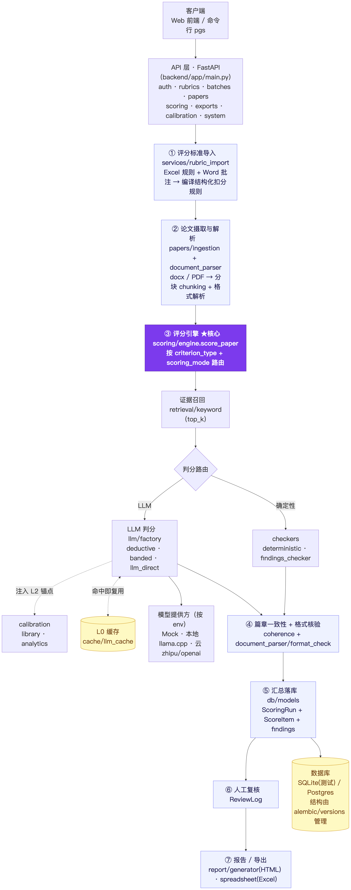

<div align="center">

# Rubric Audit Engine

**把评分标准编译成可执行规则，让 LLM 评长文档时每一分都有出处。**

[](https://github.com/liuzhne/rubric-audit-engine/actions/workflows/ci.yml)


[快速开始](#快速开始) · [工作原理](#工作原理) · [文档](#文档)

</div>

<p align="center"></p>

用 LLM 给论文、技术方案打分，难点不在“让模型给个分”，而在：同一份材料两次打分要一致，每处扣分要能指回原文，老师要能改，改完要可追溯。Rubric Audit Engine 把这几件事做进了内核。

- **规则来自标准，不写在代码里**：Excel / Word 评分标准编译成原子规则，逐条人工签核后冻结成版本。
- **确定性优先**：字数、结构、图表、引文、格式由代码判定，只有需要判断的项才交给 LLM。
- **证据强制**：每一处扣分、每一次选档都必须附原文证据，输出经结构校验后才计分。
- **人在回路**：需要人判断的项进入复核队列，改分留审计日志并重算总分。
- **用教师评分度量**：以 QWK 衡量与教师评分的一致性，作为上线与回归门禁。
- **多租户**：PostgreSQL RLS 隔离组织，用户可自带模型密钥（BYOK）。

## 快速开始

不需要数据库，也不需要 API Key（`--mock` 使用本地 Mock 模型）：

```bash
git clone https://github.com/liuzhne/rubric-audit-engine && cd rubric-audit-engine
uv sync
uv run pgs score examples/thesis.docx --no-db --rubric-file examples/rubric.xlsx --mock
```

```text
┏━━━━━━━━━━━━━┳━━━━━━━┳━━━━━━┳━━━━━━━━┳━━━━━━━┳━━━━━━┓
┃ 文件        ┃ 总分  ┃ 等级 ┃ 需复核 ┃ Token ┃ 状态 ┃
┡━━━━━━━━━━━━━╇━━━━━━━╇━━━━━━╇━━━━━━━━╇━━━━━━━╇━━━━━━┩
│ thesis.docx │ 80.78 │ 良好 │ 是     │ 0     │ ok   │
└─────────────┴───────┴──────┴────────┴───────┴──────┘
```

Mock 的分数只用来验证流程跑通；加 `--json` 可看逐项扣分与证据。

启动完整服务（Web 工作台 + API + 后台 worker）：

```bash
cp .env.intranet.example .env.intranet   # 改掉里面的密码与密钥
docker compose --env-file .env.intranet up -d --build
```

打开 `https://localhost/workbench/`，用 `.env.intranet` 里的账号登录；接口文档在 `/docs`。接入真实模型（OpenAI、智谱等 OpenAI 兼容服务、Claude、本地模型）见 [模型接入](docs/integrations.md)。

## 工作原理

```text
评分标准 (Excel / Word) ─ 编译 ─► 原子规则 ─ 人工签核 ─► 冻结版本 ─┐
                                                                  ▼
文档 (DOCX / PDF) ─ 解析 ─► 不可变快照 ─► 确定性检查 + LLM 判断（必带证据）
                                                                  ▼
                                    分数与证据 ─► 人工复核 ─► 报告 / Excel
```

内置三种评分对象：学术论文 `thesis / thesis-legacy-profile@1`、通用文档 `general_document / general-document-profile@1`、技术方案 `technical_proposal / technical-proposal-profile@1`。

## 文档

| | |
|---|---|
| [架构](ARCHITECTURE.md) | 模块边界与调用链 |
| [设计决策](DECISIONS.md) | 每个取舍选了什么、放弃了什么 |
| [运行手册](RUNBOOK.md) | 启动、测试、排错、发布 |
| [部署](docs/部署.md) | 单机 Docker 与生产部署 |
| [CLI 参考](docs/CLI.md) | `pgs` 全部命令 |
| [QWK 评估](backend/app/eval/README.md) | 如何用教师评分验收 |

## 项目状态

Python 3.10+（CI 以 3.12 锁文件验证）· PostgreSQL 16 · Alembic head `0041_assistant_agent_state`。
`SCORING_ENGINE_MODE` 默认 `legacy`，只影响未版本化的旧标准；改为默认 Core 须先通过 GATE-03 并取得维护者批准。

```bash
uv run pytest   # 全套自包含：内存 SQLite + Mock 模型，无需联网
```
